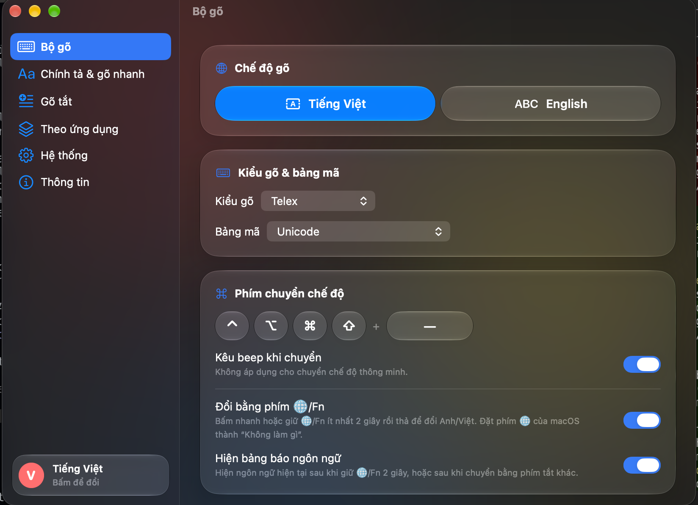
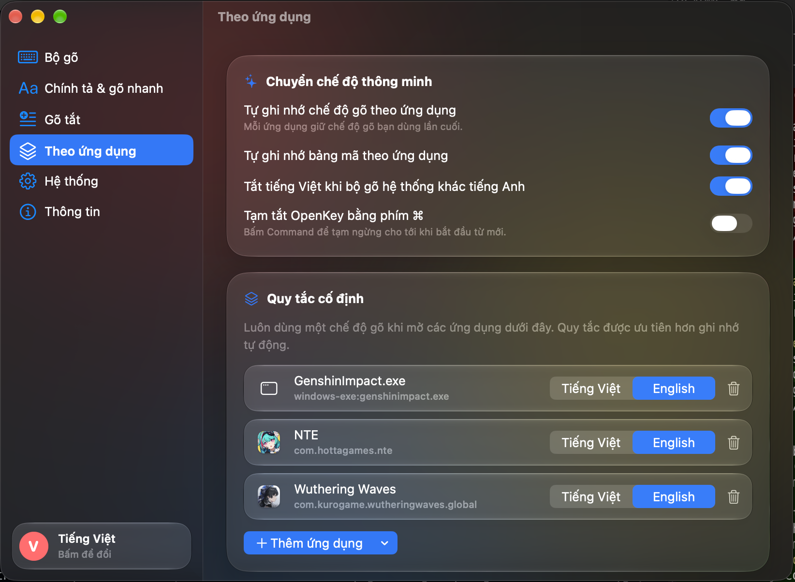

# OpenKey

[](https://github.com/ducvd89/OpenKey/releases/latest)

Bộ gõ tiếng Việt nguồn mở cho macOS. OpenKey gõ bằng kỹ thuật `Backspace` nên chữ đang gõ không bị gạch chân như bộ gõ mặc định của macOS.

### [Tải bản mới nhất](https://github.com/ducvd89/OpenKey/releases/latest)

Đây là một bản fork của [OpenKey](https://github.com/tuyenvm/OpenKey) do Mai Vũ Tuyên phát triển. Bản fork chỉ phát hành cho macOS.





## Tính năng

**Kiểu gõ và bảng mã**
- Kiểu gõ: Telex, VNI, Simple Telex 1 và 2.
- Bảng mã: Unicode dựng sẵn, Unicode tổ hợp, TCVN3 (ABC), VNI Windows, Vietnamese Locale CP 1258.
- Đặt dấu kiểu cũ (òa, úy) hoặc kiểu mới (oà, uý), và cho phép bỏ dấu tự do.

**Chuyển Anh ↔ Việt**
- Phím tắt tuỳ chọn, hoặc bấm nhanh phím 🌐/Fn. Giữ 🌐/Fn 2 giây để xem bảng báo ngôn ngữ.
- Quy tắc theo ứng dụng: đặt cố định Tiếng Việt hoặc English cho từng ứng dụng, kể cả ứng dụng Windows chạy qua Wine hoặc CrossOver.
- Tự ghi nhớ chế độ gõ và bảng mã bạn dùng lần cuối ở mỗi ứng dụng.
- Tự chuyển sang English khi con trỏ ở trong ô mật khẩu, rồi trả lại chế độ cũ khi rời đi.
- Tạm tắt tiếng Việt khi bàn phím hệ thống không phải tiếng Anh.

**Chính tả và từ tiếng Anh**
- Kiểm tra chính tả tiếng Việt, có thể tạm tắt bằng phím ⌃.
- Tự khôi phục phím với từ sai: từ không hợp lệ và từ tiếng Anh bị Telex làm hỏng (`pass`, `issue`, `data`) được trả lại đúng các phím đã gõ.
- Nhận diện tiếng Anh theo ngữ cảnh: sau các từ như `the`, `and`, `with`, những từ trùng với tiếng Việt như `this`, `list`, `tax` được giữ nguyên.
- Cho phép dùng `z w j f` làm phụ âm.

**Gõ nhanh và gõ tắt**
- Gõ nhanh Telex: `cc`=ch, `gg`=gi, `kk`=kh, `nn`=ng, `qq`=qu, `pp`=ph, `tt`=th.
- Gõ tắt phụ âm đầu (`f`→ph, `j`→gi, `w`→qu) và phụ âm cuối (`g`→ng, `h`→nh, `k`→ch).
- Viết hoa chữ cái đầu câu.
- Bảng gõ tắt không giới hạn độ dài, dùng được cả khi đang gõ tiếng Anh.

**Công cụ và hệ thống**
- Chuyển mã văn bản giữa các bảng mã ở trên, có phím tắt chuyển nhanh nội dung trong clipboard.
- Sửa lỗi lặp chữ ở thanh địa chỉ trình duyệt và ô có gợi ý như trong Excel.
- Chế độ "Gửi từng phím" cho ứng dụng không tương thích, và chế độ tương thích với layout Dvorak, Colemak.
- Bỏ qua chuỗi phím do chương trình gõ, như trình gõ tắt hay tự điền mật khẩu.
- Menu báo ứng dụng nào đang giữ Secure Input, là lúc OpenKey không nhận được phím.
- Khởi động cùng macOS, biểu tượng đơn sắc trên thanh menu, tuỳ chọn hiện biểu tượng trên Dock.
- Kiểm tra bản mới qua trang Releases. Khi có bản mới, OpenKey mở trang tải về chứ không tự cài.

Thay đổi của từng bản nằm ở trang [Releases](https://github.com/ducvd89/OpenKey/releases).

## Cài đặt

Yêu cầu macOS 13 trở lên, chạy trên cả Apple Silicon và Intel.

1. Tải file `dmg` mới nhất từ trang [Releases](https://github.com/ducvd89/OpenKey/releases/latest).
2. Mở file `dmg` rồi kéo `OpenKey.app` vào thư mục `Applications`.
3. Bản build chưa được Apple notarize. Lần đầu mở, hãy chuột phải vào `OpenKey.app` rồi chọn **Mở**.
4. Cấp quyền khi OpenKey yêu cầu: vào *System Settings → Privacy & Security → Accessibility* và bật `OpenKey`. Đừng tắt quyền này khi đang dùng OpenKey.

Lưu ý:
- Nên tắt hẳn các bộ gõ tiếng Việt khác. Hai bộ gõ chạy cùng lúc sẽ xung đột và gõ sai.
- Bản fork dùng bundle ID `app.cid.openkey`, khác OpenKey gốc, nên cài đặt và quyền Trợ năng của hai bản tách riêng nhau.
- Lệnh `brew install --cask openkey` cài OpenKey gốc, không phải bản fork này.

## Phát triển

- Mã nguồn macOS nằm ở `Sources/OpenKey/macOS`. Mở `OpenKey.xcodeproj` bằng Xcode để build; xem thêm [macOS_Build.md](macOS_Build.md).
- Bộ máy gõ nằm ở `Sources/OpenKey/engine`. Chạy bộ kiểm thử của nó bằng:

```
$ Sources/OpenKey/engine/tests/run.sh
```

Bộ kiểm thử gồm các ca cố định, kiểm tra gõ đi gõ lại từ tiếng Việt, đếm số từ tiếng Anh bị gõ sai, và gõ phím ngẫu nhiên dưới AddressSanitizer.

- Repo vẫn giữ mã nguồn [Windows](Sources/OpenKey/win32) và [Linux](Sources/OpenKey/linux) của bản gốc. Bản fork không phát hành cho hai nền tảng này.

## Ghi công và giấy phép

- OpenKey do Mai Vũ Tuyên phát triển. Bản gốc: [github.com/tuyenvm/OpenKey](https://github.com/tuyenvm/OpenKey).
- Danh sách từ tiếng Anh trong `EnglishWords.h` dựng từ dữ liệu của dự án [VieLotus-IM](https://github.com/stevedat/VieLotus-IM), giấy phép MIT.
- Mã nguồn phát hành theo giấy phép [GPL-3.0](LICENSE). Bạn có thể tải về, tự build và sửa đổi. Nếu phân phối lại bản sửa đổi, bản đó cũng phải là mã nguồn mở và ghi rõ bản gốc là OpenKey.
