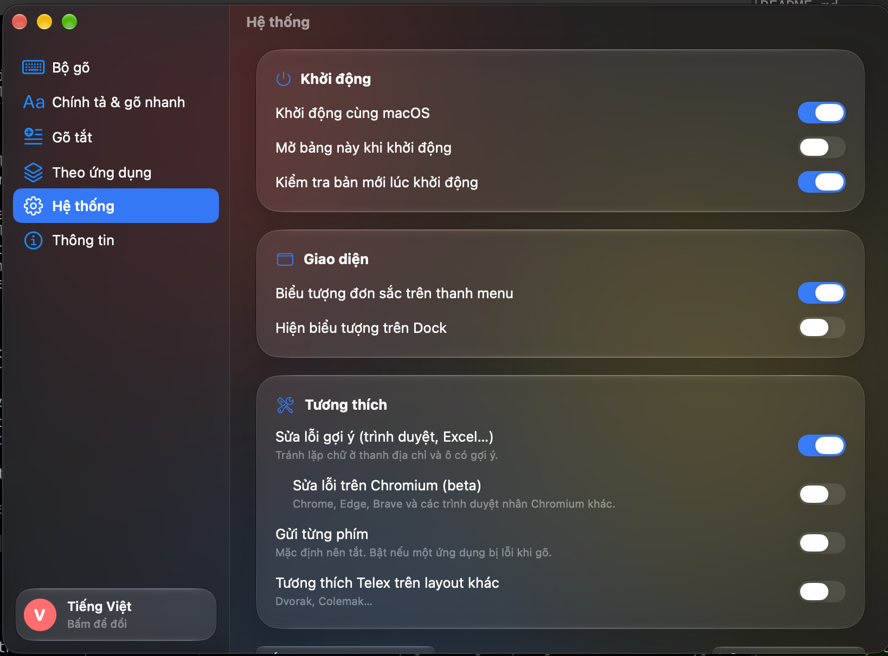

# OpenKey
### [Download bản mới nhất](https://github.com/ducvd89/OpenKey/releases/latest)
[](https://github.com/ducvd89/OpenKey/releases/latest)

Đây là một bản fork của [OpenKey gốc](https://github.com/tuyenvm/OpenKey) do Mai Vũ Tuyên phát triển. Bản fork tập trung vào macOS; các bản phát hành ở đây chỉ có cho macOS. Xem [bản fork này có gì khác](#bản-fork-này-có-gì-khác).

### Open source Vietnamese Input App for macOS - Bộ gõ tiếng Việt nguồn mở cho macOS.
Bộ gõ tiếng Việt mới cho macOS, sử dụng kỹ thuật `Backspace`. Loại bỏ lỗi gạch chân khó chịu ở bộ gõ mặc định. Hoàn toàn miễn phí và là nguồn mở, luôn cập nhật và phát triển.

### Mã nguồn của ứng dụng được mở công khai, minh bạch dưới giấy phép GPL. Điều này nghĩa là bạn hoàn toàn có thể tải mã nguồn về tự build, cải tiến theo mục đích của bạn. Nếu bạn tái phân phối bản cải tiến của bạn, thì nó cũng phải là mã nguồn mở và thông báo bản gốc là OpenKey.

### Lưu ý, khi sử dụng OpenKey, bạn nên tắt hẳn bộ gõ khác vì 2 chương trình bộ gõ sẽ xung đột nhau, dẫn đến thao tác không chính xác.




Cửa sổ Gõ tắt và Chuyển mã vẫn như bản gốc:


## Bản fork này có gì khác
- **Chế độ gõ theo ứng dụng:** đặt cố định Tiếng Việt hoặc English cho từng ứng dụng, kể cả ứng dụng Windows chạy qua Wine hoặc CrossOver (nhận theo tên tệp `.exe`).
- **Đổi chế độ bằng phím 🌐/Fn:** bấm nhanh để chuyển Anh ↔ Việt, giữ 2 giây để xem bảng báo ngôn ngữ.
- **Ô mật khẩu:** tự chuyển sang English khi con trỏ ở trong ô mật khẩu và trả lại chế độ cũ khi rời đi.
- **Giao diện mới:** bảng điều khiển SwiftUI, dùng Liquid Glass trên macOS 26 và nền mờ thường trên các bản macOS cũ hơn.
- **Từ tiếng Anh khi đang gõ tiếng Việt** (từ bản 2.2.0): *Tự khôi phục phím với từ sai* trả lại cả những từ bị Telex làm hỏng như `pass`, `issue`, `data`. Tuỳ chọn *Nhận diện tiếng Anh theo ngữ cảnh* giữ nguyên những từ trùng với tiếng Việt như `this`, `list`, `tax` khi chúng đứng sau các từ như `the`, `and`, `with`.
- **Bền hơn** (từ bản 2.2.0): tự bật lại việc bắt phím khi macOS tắt nó, bỏ qua chuỗi phím do chương trình gõ (trình gõ tắt, tự điền mật khẩu), và báo trên menu ứng dụng nào đang giữ Secure Input.
- **Tương thích trình quản lý thanh menu** như Thaw: kéo biểu tượng trên thanh menu không còn bị kẹt.
- **Kiểm tra bản mới** qua trang Releases của repo này. Khi có bản mới, OpenKey mở trang tải về chứ không tự cài.
- Bundle ID là `app.cid.openkey`, khác bản gốc, nên cài đặt và quyền Trợ năng tách riêng với OpenKey gốc.

Chi tiết từng bản nằm ở trang [Releases](https://github.com/ducvd89/OpenKey/releases).

## Hỗ trợ kiểu gõ
- Telex
- VNI
- Simple Telex

## Bảng mã thông dụng:
- Unicode (Unicode dựng sẵn).
- TCVN3 (ABC).
- VNI Windows.
- Unicode Compound (Unicode tổ hợp).
- Vietnamese Locale CP 1258.
- ...

## Tính năng:
- **Modern orthography** (On/Off) - Đặt dấu oà, uý thay vì òa, úy.
- **Quick Telex** (On/Off) - Gõ nhanh (cc=ch, gg=gi, kk=kh, nn=ng, qq=qu, pp=ph, tt=th).
- **Grammar check** (On/Off) - Kiểm tra ngữ pháp.
- **Spelling check** (On/Off) - Kiểm tra chính tả.
- **Restore key if invalid word** (on/off) - Phục hồi phím với từ sai, gồm cả từ tiếng Anh bị Telex làm hỏng (Bản 2.2.0 về sau).
- **Run on startup** (On/Off) - Chạy cùng macOS.
- **Gray menu bar icon** (On/Off) - Biểu tượng xám trên thanh menu phù hợp với chế độ Dark mode.
- **Switch input mode by shortcut key** - Đổi chế độ gõ bằng phím tắt tùy chọn.
- **Autocorrect fixed** (On/Off) - Sửa lỗi autocorrect trên trình duyệt như Chrome, Safari, Firefox, Microsoft Excel.
- **Underline issue fixed on macOS** (On/Off) - Sửa lỗi gạch chân trên macOS.
- **Tạm tắt kiểm tra chính tả bằng phím Ctrl** (On/Off) (Bản 1.5 về sau).
- **Tạm tắt OpenKey bằng phím Cmd/Alt** (On/Off) (Bản 2.0.1 về sau).
- **Cho phép dùng f z w j làm phụ âm đầu** (On/Off) (Bản 1.5 về sau).
- **Gõ tắt phụ âm đầu: f->ph, j->gi, w->qu** (On/Off) (Bản 1.6 về sau).
- **Gõ tắt phụ âm cuối: g->ng, h->nh, k->ch** (On/Off) (Bản 1.6 về sau).
- **Hiện biểu tượng trên thanh Dock** (On/Off) (Bản 2.0.1 về sau). Bấm vào icon trên thanh Dock sẽ mở nhanh Bảng điều khiển.
- **Macro** - Tính năng gõ tắt vô cùng tiện lợi. Gõ tắt của macOS chỉ hỗ trợ 20 ký tự, còn OpenKey không giới hạn ký tự.
- **Chuyển chế độ thông minh:** (On/Off) (Bản 1.2 về sau) - Bạn đang dùng chế độ gõ Tiếng Việt trên ứng dụng A, bạn chuyển qua ứng dụng B trước đó bạn dùng chế độ gõ Tiếng Anh, OpenKey sẽ tự động chuyển qua chế độ gõ Tiếng Anh cho bạn, khi bạn quay lại ứng dụng A, OpenKey tất nhiên sẽ chuyển lại chế độ gõ tiếng Việt, rất cơ động.
- **Viết Hoa chữ cái đầu câu** (On/Off) (Bản 1.2 về sau) - Khi gõ văn bản dài, đôi khi bạn quên ghi hoa chữ cái đầu câu khi kết thúc một câu hoặc khi xuống hàng, tính năng này sẽ tự ghi hoa chữ cái đầu câu cho bạn, thật tuyệt vời.
- **Chế độ “Gửi từng phím”:** (On/Off) (Bản 1.1 về sau) mặc định dùng kỹ thuật mới gửi dữ liệu 1 lần thay vì gửi nhiều lần cho chuỗi ký tự, nên nếu có ứng dụng nào không tương thích, hãy bật tính năng này lên, mặc định thì nên tắt vì kỹ thuật mới sẽ chạy nhanh hơn.
- **Cập nhật tự động:** (Bản 1.3 về sau) tính năng hỗ trợ cập nhật phiên bản OpenKey mới nhất mỗi khi mở OpenKey hoặc tự check trong phần mục Giới thiệu.
- **Công cụ chuyển mã:** (Bản 1.4 về sau) hỗ trợ chuyển mã qua lại văn bản, thích hợp cho việc chuyển đổi văn bản cũ viết bằng VNI, TCVN3 qua Unicode,... Hỗ trợ cấu hình phím tắt chuyển mã nhanh, bảng cấu hình tùy chọn chuyển mã.
- **Tự ghi nhớ bảng mã theo ứng dụng:** (Bản 2.0.1 về sau) Phù hợp cho các bạn dùng Photoshop, CAD,... với các bảng mã VNI, TCVN3. OpenKey tự ghi nhớ ứng dụng nào dùng bảng mã nào để lần sau sử dụng Photoshop, CAD,... OpenKey có thể tự chuyển sang bảng mã đó.
- ...


[Changelog của bản gốc](CHANGELOG.md) · [Các bản phát hành của bản fork](https://github.com/ducvd89/OpenKey/releases)

## Cài đặt:
Yêu cầu macOS 13 trở lên. Bản build chạy được trên cả Apple Silicon và Intel.

**Cài đặt thủ công:**  
Tải bản OpenKey mới nhất từ [đây](https://github.com/ducvd89/OpenKey/releases/latest), mở file `dmg` ra rồi kéo thả `OpenKey.app` vào thư mục `Applications`.

Bản build chưa được Apple notarize. Lần đầu mở, hãy chuột phải vào `OpenKey.app` rồi chọn **Mở**.

**Cài bằng Homebrew:** (by nhymxu)  
Lưu ý: Homebrew cài **bản gốc**, không phải bản fork này.

Nếu chưa cài Homebrew, mở terminal, nhập:
```
$ /usr/bin/ruby -e "$(curl -fsSL https://raw.githubusercontent.com/Homebrew/install/master/install)"
```

Kiểm tra phiên bản OpenKey:
```
$ brew info --cask openkey
```
Gõ lệnh sau để homebrew tự cài OpenKey cho bạn:
```
$ brew install --cask openkey
```

Để update phiên bản mới nhất của OpenKey
```
$ brew upgrade --cask openkey
```

## Note - Lưu ý:
OpenKey cần cấp quyền, vào *System Settings -> Privacy & Security -> Accessibility* (trên macOS cũ là *System Preferences -> Security & Privacy -> Accessibility*), kích hoạt `OpenKey.app`. **Không tắt nó khi đang dùng OpenKey**.
.

## Dành cho người phát triển
- Cách build bản macOS: [macOS_Build.md](macOS_Build.md).
- Bộ máy gõ dùng chung cho các nền tảng nằm ở `Sources/OpenKey/engine`. Chạy bộ kiểm thử của nó bằng:
```
$ Sources/OpenKey/engine/tests/run.sh
```
Bộ kiểm thử gồm các ca cố định, kiểm tra gõ đi gõ lại từ tiếng Việt, đếm số từ tiếng Anh bị gõ sai, và gõ phím ngẫu nhiên dưới AddressSanitizer.
- Danh sách từ tiếng Anh trong `EnglishWords.h` dựng từ dữ liệu của dự án [VieLotus-IM](https://github.com/stevedat/VieLotus-IM) (giấy phép MIT).

## Tác giả
- Tác giả OpenKey: Mai Vũ Tuyên.
- Góp ý cho bản gốc gửi tới maivutuyen.91@gmail.com  
- Fanpage: [https://www.facebook.com/OpenKeyVN](https://www.facebook.com/OpenKeyVN)
- Bản fork này được duy trì tại [github.com/ducvd89/OpenKey](https://github.com/ducvd89/OpenKey).

## Liên kết
- [OpenKey gốc](https://github.com/tuyenvm/OpenKey)
- [OpenKey cho Windows, xem chi tiết tại đây](Sources/OpenKey/win32)
- [OpenKey cho Linux (đang phát triển)](Sources/OpenKey/linux)
## Một điều nhỏ nhoi
Đừng quên ủng hộ tác giả gốc bằng cách mua ly cafe cho tác giả tỉnh ngủ nhé:  
[Buy me a coffee ^^](https://tuyenvm.github.io/donate.html)  
[Redbull cũng được ^^](https://paypal.me/tuyenmai)  
Hoặc trực tiếp qua ví momo:   
.   

Cảm ơn các bạn rất nhiều.
